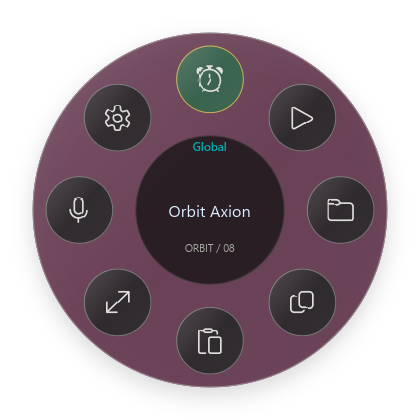
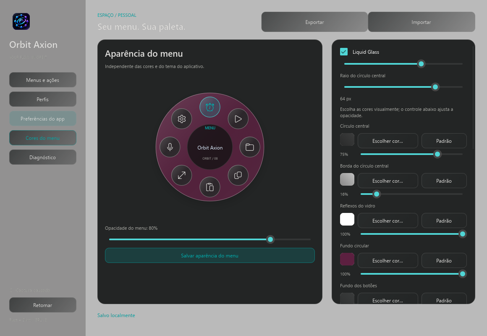
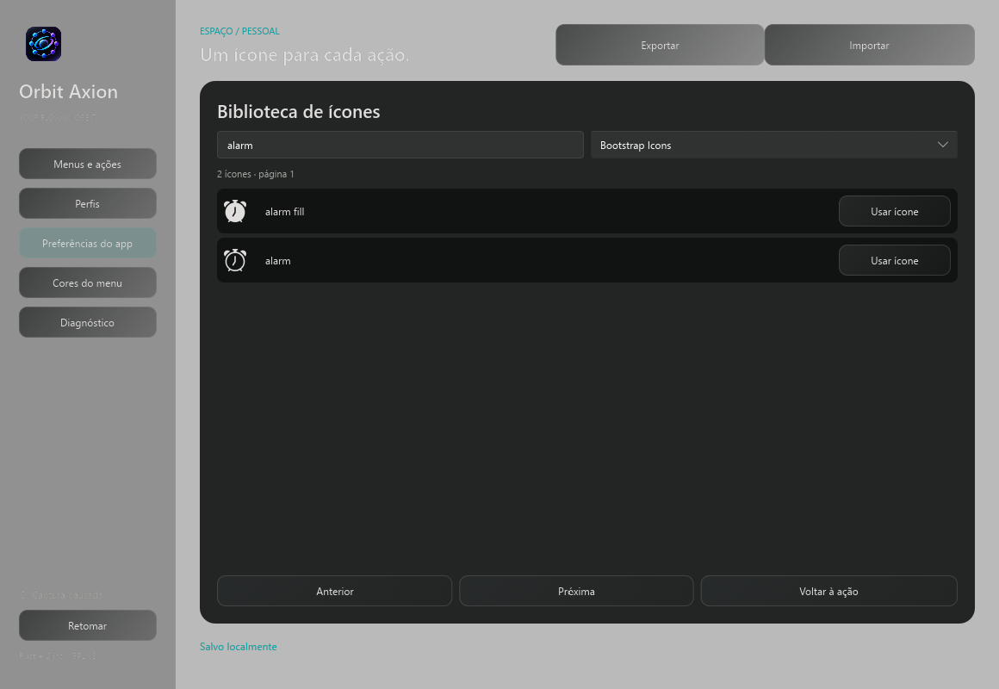
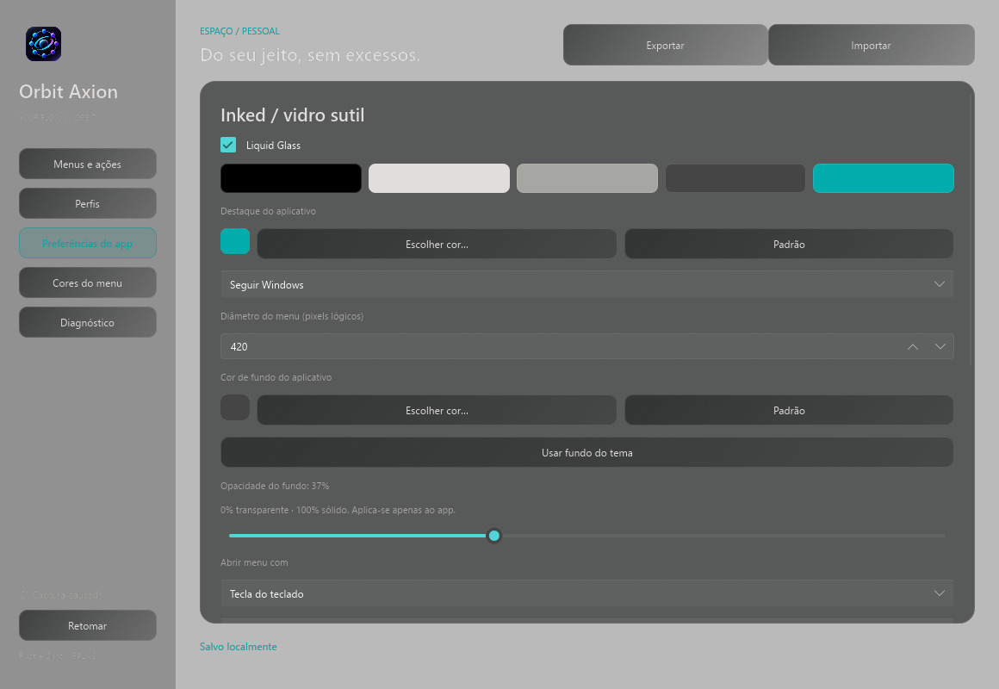

<p align="center">
  
</p>

<p align="center">
  <a href="https://github.com/whoslucaxs/orbit-axion/actions/workflows/ci.yml"></a>
  
  
  <a href="LICENSE"></a>
</p>

<p align="center">
  <strong>Oito ações ao alcance do mouse. Um menu para cada contexto.</strong><br>
  Menu radial para Windows, com perfis por aplicativo, atalhos, macros e controle de áudio.<br>
  Desenvolvido em Rust + Slint, independente de periféricos Logitech.
</p>

<p align="center">
  <a href="https://github.com/whoslucaxs/orbit-axion/releases/tag/v0.2.9">Baixar v0.2.9</a> ·
  <a href="#primeiros-passos">Primeiros passos</a> ·
  <a href="#sua-aparência-seu-menu">Personalização</a> ·
  <a href="docs/DEVELOPMENT.md">Compilar e testar</a> ·
  <a href="CHANGELOG.md">Novidades</a>
</p>

## Menos caminhos. Mais ações.

Segure o botão, aponte para uma ação e solte. Ou use o modo clique para navegar com calma. O anel aparece no cursor sem tomar o foco do aplicativo em uso.

<p align="center">
  
</p>

| Para o seu fluxo | O que você pode configurar |
| --- | --- |
| **Ações do dia a dia** | Aplicativos, sites, arquivos, atalhos, texto, mídia e comandos de janela. |
| **Contextos diferentes** | Perfis por executável, prioridades, herança do Global e seleção manual. |
| **Mais espaço** | Submenus, busca e macros com cancelamento. |
| **Áudio na roda do mouse** | Volume do Windows por saída ou endpoint; integração com Voicemeeter Potato. |
| **Seu acionador** | Cinco botões padrão do mouse ou uma tecla do teclado; modo clique ou segurar. |
| **Tudo local** | JSON, backups, importação e exportação de configurações com os ícones. |

## Sua aparência, seu menu

O aplicativo e o menu têm paletas independentes. Escolha cores com o seletor visual, ajuste transparência e personalize fundo, borda e ícone de cada botão. O círculo central também tem cor, borda e raio próprios.



*Captura real do app com uma configuração de demonstração. As cores e a transparência são ajustáveis.*

- **Liquid Glass opcional:** transparência, relevo e reflexos discretos, com controles separados para app e menu.
- **4.312 ícones de biblioteca:** Bootstrap e Material, além dos SVGs do Voicemeeter e ChatGPT. Busca e uso offline.
- **Ícone automático do programa:** selecione ou cole o caminho de um EXE/LNK na ação e o botão recebe o ícone dele.
- **Filtros por botão:** preto e branco, brilho, contraste e inversão, com prévia e restauração da imagem original.

<details>
<summary><strong>Ver a biblioteca de ícones</strong></summary>



</details>

<details>
<summary><strong>Ver as preferências do aplicativo</strong></summary>



</details>

## Primeiros passos

**Requisitos:** Windows 11 x64 e [Microsoft Visual C++ Runtime x64](https://learn.microsoft.com/en-us/cpp/windows/latest-supported-vc-redist). O MSI atual não instala esse runtime.

A **[v0.2.9 está disponível nas Releases](https://github.com/whoslucaxs/orbit-axion/releases/tag/v0.2.9)**:

- **[Baixar instalador MSI](https://github.com/whoslucaxs/orbit-axion/releases/download/v0.2.9/OrbitAxion-0.2.9-x64.msi)** — instalação com atalho no Windows.
- **[Baixar executável EXE](https://github.com/whoslucaxs/orbit-axion/releases/download/v0.2.9/OrbitAxion-0.2.9.exe)** — execução direta.
- [Checksums SHA-256](https://github.com/whoslucaxs/orbit-axion/releases/download/v0.2.9/SHA256SUMS-0.2.9.txt), avisos e licença acompanham a release.

O acesso aos downloads de um repositório privado exige login no GitHub com permissão de leitura. Para gerar seus próprios pacotes, consulte o [guia de desenvolvimento](docs/DEVELOPMENT.md).

1. Abra o Orbit Axion e entre em **Menus e ações**.
2. Escolha uma das oito posições, defina a ação e clique em **Salvar ação**.
3. Em **Preferências do app**, selecione o botão do mouse ou a tecla para abrir o menu e aplique as preferências.
4. Volte a outro aplicativo e teste o acionador escolhido.

**Ao atualizar:** escolha **Sair** na bandeja antes de abrir a versão nova. Fechar apenas a janela mantém o Orbit em execução.

<details>
<summary><strong>Como funcionam os controles?</strong></summary>

| Controle | Comportamento |
| --- | --- |
| Segurar | Mantenha o acionador pressionado, aponte para a ação e solte. |
| Clique | Abra com um clique e selecione a ação no menu. |
| Submenus no modo segurar | Pare 300 ms sobre um submenu para entrar; soltar encerra o gesto. |
| Roda sobre volume | Ajusta o volume; soltar após rolar não executa outra ação. |
| Teclado | Escolha uma tecla individual na lista ou use a captura. Repetições não reabrem o menu. |
| Dentro do editor | O acionador fica livre para permitir a configuração e a digitação. |

Botões extras do fabricante precisam ser mapeados pelo driver para um botão padrão reconhecido pelo Windows. A captura aceita uma tecla individual, sem combinação de modificadores.

</details>

## Feito para ficar no seu computador

As configurações ficam em `%LOCALAPPDATA%/OrbitAxion`, com gravação atômica, recuperação de arquivos inválidos e até 30 backups. Não há telemetria, sincronização em nuvem ou histórico de ações. A verificação de atualizações consulta o GitHub; instalação e inicialização com Windows são opcionais.

A integração com Voicemeeter Potato exige uma instalação local em execução. A DLL proprietária da VB-Audio não acompanha o app.

## Desenvolvimento

Windows x64, Rust MSVC **1.95+**, Build Tools C++ e Windows SDK:

```powershell
cargo build --locked --release -p orbit-axion --bins
.\target\release\orbit-axion.exe
```

O [guia de desenvolvimento](docs/DEVELOPMENT.md) reúne comandos de teste, diagnósticos, geração do MSI, configuração do updater e organização do código. O CI sempre compila, testa e verifica o pacote; o upload de arquivos é opcional na execução manual para não depender da cota de artifacts em cada push.

| Leia também | Conteúdo |
| --- | --- |
| [Changelog](CHANGELOG.md) | Evolução das versões. |
| [Validação local](docs/VALIDATION.md) | O que foi verificado em cada versão. |
| [Plano de testes](docs/TEST_PLAN.md) | Cenários de hardware e validação manual. |
| [Especificação](docs/SPEC.md) | Referência de produto. |
| [Dependências e distribuição](THIRD_PARTY.md) | Bibliotecas, ícones e avisos de licença. |

### Estado do projeto

Versão **0.2.9**, em desenvolvimento. O efeito Liquid Glass é uma adaptação visual para Slint. Instalação, upgrade e rollback do MSI em VM, jogos, processos elevados, múltiplos DPIs e acessibilidade ainda precisam de validação dedicada. A busca sem foco não suporta composição IME; nesse caso, use a seleção pelo mouse.

## Licença

Código sob [GPL-3.0-only](LICENSE). Bibliotecas, fontes e marcas de terceiros mantêm suas próprias licenças. Este é um projeto independente, sem vínculo com a Logitech.
